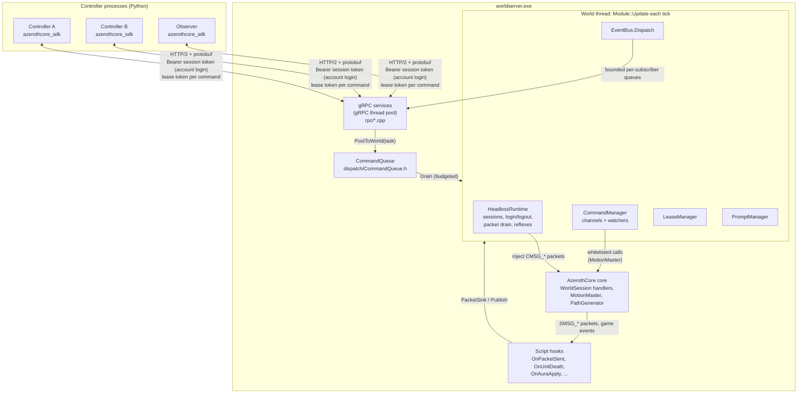
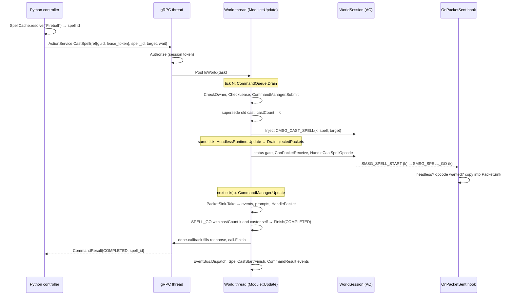

# AzerothCore SDK: architecture and implementation

A companion for reading the source. It explains what each part of the project does, why it is shaped that
way, and where to find it, so you can follow along file by file.

The project is two repositories: this one, **mod-acsdk** (the AzerothCore module and the gRPC protos), and
**[AzerothCore-SDK](https://github.com/SimianJake/AzerothCore-SDK)** (the Python package, examples and integration tests). Links into the SDK
repository point at GitHub.

- **Design source of truth:** [PLAN.md](https://github.com/SimianJake/AzerothCore-SDK/blob/main/PLAN.md) (goals, invariants, decision log in §13).
- **How to use the SDK:** [SDK_GUIDE.md](https://github.com/SimianJake/AzerothCore-SDK/blob/main/docs/SDK_GUIDE.md). This document does not repeat it.
- **Installing the module:** [README.md](../README.md); detailed Windows recipe: [windows-build.md](windows-build.md).
- **Research behind the design:** [research/core-gaps.md](research/core-gaps.md),
  [research/headless-sessions.md](research/headless-sessions.md), [research/opcode-map.md](research/opcode-map.md),
  and the event source table [events.md](events.md).

Describes mod-acsdk **1.0.0** and SDK **1.0.0**, AzerothCore master
`0540ae80` (minimum `92fed92ea`).

---

## Contents

1. [What the project is](#1-what-the-project-is)
2. [The big picture](#2-the-big-picture)
3. [Five ideas that explain most of the code](#3-five-ideas-that-explain-most-of-the-code)
4. [Server module walkthrough (mod-acsdk)](#4-server-module-walkthrough-mod-acsdk)
5. [The wire API (protos)](#5-the-wire-api-protos)
6. [Python SDK walkthrough (azerothcore_sdk)](#6-python-sdk-walkthrough-azerothcore_sdk)
7. [Life of a command, end to end](#7-life-of-a-command-end-to-end)
8. [Tests](#8-tests)
9. [Build scripts](#9-build-scripts)
10. [A suggested reading order](#10-a-suggested-reading-order)
11. [Things noticed while reading](#11-things-noticed-while-reading)

---

## 1. What the project is

A Python SDK for driving **headless characters** on an AzerothCore (WoW 3.3.5a) server. A headless character
is an ordinary player character that is logged into the world with no game client and no network socket.

There are two halves:

| Half | Language | Lives in | Role |
|---|---|---|---|
| **mod-acsdk** | C++ | [mod-acsdk](../) | An AzerothCore module compiled into `worldserver.exe`. It logs characters in without a socket, hosts a gRPC server, turns RPCs into the packets a game client would send, and reports what the server answered. |
| **azerothcore_sdk** | Python (asyncio) | [python/azerothcore_sdk/](https://github.com/SimianJake/AzerothCore-SDK/tree/main/python/azerothcore_sdk/) | The client library a controller script imports: `await char.move_to(...)`, `await char.cast("Fireball", target=mob)`, event streams, helpers like `kill()` and `travel()`. |

They talk over gRPC (HTTP/2 + protobuf) on `127.0.0.1:50051`. The contract between them is the `.proto` files in
[proto/acsdk/v1/](../proto/acsdk/v1/).

### Goals, in short ([PLAN.md §3](https://github.com/SimianJake/AzerothCore-SDK/blob/main/PLAN.md))

1. **Character state is 100% controller-owned.** The server never decides anything for a character and never
   resets it.
2. **Many controllers, many characters.** Each character has at most one driver at a time; anyone may observe.
3. **Every action is awaitable** and resolves when it really completes or fails, with a reason.
4. Game state, server-side pathfinding and chat are exposed.
5. Event streams (chat, combat, death, auras, casts, loot, level-up, command results, opt-in raw packets).
6. **Misuse must never crash or stall worldserver.**

And one rule that shapes everything: **the runtime never acts on its own.** No AI, no auto-anything. The only
automatic behaviour allowed is a short list of mechanical "protocol reflexes" a real client would perform (§3.5
below).

Out of scope: creating accounts or characters (except the dev-only DebugService), controlling real players,
internet exposure, performance targets.

---

## 2. The big picture



The same thing in words:

1. A controller calls an RPC. A gRPC thread resolves its account session and **posts a task** to the world thread,
   which checks the character belongs to that account. The gRPC thread never touches a game object.
2. Once per world tick, `Module::Update` drains the task queue (within a budget), then pumps the headless
   sessions, the command watchers, prompts, leases, state diffs and finally the event bus.
3. Actions are performed by **injecting the client packet** (`CMSG_CAST_SPELL`, `CMSG_ATTACKSWING`, ...) into the
   character's `WorldSession`, so AzerothCore's own handlers apply every game rule.
4. The server's replies (`SMSG_*`) are captured by a hook, matched to the command that caused them, and become the
   command result and events.

### Repository map

| Path | What is there |
|---|---|
**This repository (mod-acsdk).** Its root is the module: it is cloned as `azerothcore-wotlk/modules/mod-acsdk`.

| Path | What is there |
|---|---|
| [src/](../src/) | The C++ module sources (the only part AzerothCore compiles) |
| [conf/mod_acsdk.conf.dist](../conf/mod_acsdk.conf.dist) | Config template (AzerothCore installs it with the other module configs) |
| [mod-acsdk.cmake](../mod-acsdk.cmake) | Build hook: gRPC/protobuf, generated proto code, optional packet tests |
| [proto/acsdk/v1/](../proto/acsdk/v1/) | The API: `server`, `character`, `lease`, `action`, `world`, `event`, `debug`, `common` |
| [tests/cpp/PacketTests.cpp](../tests/cpp/PacketTests.cpp) | Golden-byte tests for packet builders and decoders |
| [deps/vcpkg.json](../deps/vcpkg.json) | Windows native deps (Boost, OpenSSL, gRPC, protobuf) |
| [scripts/](../scripts/) | Windows build/run scripts, Python enum-name generator |
| [docs/](.) | This file, Windows build recipe, research, event table |

**The SDK repository** ([AzerothCore-SDK](https://github.com/SimianJake/AzerothCore-SDK)): `PLAN.md`, `python/azerothcore_sdk/` (the pip package),
`examples/`, `tests/` (pytest integration suite against a real worldserver it starts itself), a copy of `proto/`
matching a module version, and the user docs.

On the maintainer's Windows machine the AzerothCore source sits next to this repo (`..\azerothcore-wotlk`) and
everything built lives under `C:\acsdk-build` (`ac\` build tree, `vcpkg_installed\`, `mysql\`, `data\` map
files). Paths are set in [scripts/env.ps1](../scripts/env.ps1).

---

## 3. Five ideas that explain most of the code

### 3.1 Plumbing and porcelain ([PLAN.md §4.0](https://github.com/SimianJake/AzerothCore-SDK/blob/main/PLAN.md))

Borrowed from git. The C++ module and the protos are **plumbing**: small, mechanical primitives that map about 1:1
onto AzerothCore concepts ("move to point", "cast spell id on guid", "nearby objects"). Everything convenient is
**porcelain** in Python: spell-name lookup, `kill()`, `travel()`, `recover()`, lease auto-renewal.

The placement rule: a feature goes into C++ only if it needs AC internals that are not exposed, must react within
a server tick, or would cost too many round trips otherwise. You can see the split in the Python package too:
`azerothcore_sdk.plumbing` is 1:1 over the stubs, the top level and `helpers/` are porcelain.

### 3.2 Act like a client: packets in, packets out ([PLAN.md §4.6](https://github.com/SimianJake/AzerothCore-SDK/blob/main/PLAN.md))

The module does not implement game behaviour. To cast a spell it builds the exact `CMSG_CAST_SPELL` a 3.3.5a
client would send and queues it into the character's session. AC's handler then checks range, line of sight,
cooldowns, reagents and everything else. The answer comes back as `SMSG_SPELL_GO` or `SMSG_CAST_FAILED`, and its
reason code (`SPELL_FAILED_OUT_OF_RANGE`) is what the controller sees.

There is a short **whitelist** of direct core calls, each for a job no client opcode can do
([PLAN.md §4.6.3](https://github.com/SimianJake/AzerothCore-SDK/blob/main/PLAN.md)):

| Direct call | Why it is allowed | Where |
|---|---|---|
| Constructing a socketless `WorldSession`, AC's own async character load, `LogoutPlayer` | The client equivalent is a network connection, not an opcode | [HeadlessRuntime.cpp](../src/runtime/HeadlessRuntime.cpp) |
| `MotionMaster::MovePoint` / `MoveFollow` / `Clear`, `SetFacingTo` | A real client simulates movement and reports positions; there is no client here | [Commands.cpp:211](../src/commands/Commands.cpp#L211) |
| `MotionMaster::MoveKnockbackFrom` on `SMSG_MOVE_KNOCK_BACK` | Owner decision 2026-10-22: no client exists to simulate the arc | [Commands.cpp:468](../src/commands/Commands.cpp#L468) |
| `HandleMoveWorldportAck`, `HandleMoveTeleportAck` | Teleport acks a client sends automatically | [HeadlessRuntime.cpp:413](../src/runtime/HeadlessRuntime.cpp#L413) |
| Read-only queries: `PathGenerator`, `GetHeight`, LoS, grid searchers, spell/item/creature stores, reading `Player` fields | Pure reads | [WorldService.cpp](../src/rpc/WorldService.cpp), [CharacterService.cpp](../src/rpc/CharacterService.cpp) |

Explicitly forbidden: calling `Player::CastSpell` for a player cast, writing our own range or cooldown checks,
granting loot or quest credit, editing inventory, money, health or auras.

### 3.3 Threads: gRPC threads never touch the game ([PLAN.md §4.1](https://github.com/SimianJake/AzerothCore-SDK/blob/main/PLAN.md))

AzerothCore game objects are not thread-safe. Maps update on worker threads; `WorldScript::OnUpdate` runs on the
main (world) thread **after** all map updates have joined, so it is a safe place to touch players
([research/headless-sessions.md](research/headless-sessions.md), item 5).

So the rule is:

- **gRPC threads** resolve the session token, copy request fields, post a task, and write the response. Nothing else.
- **The world thread** does every game read and write, inside `Module::Update`.
- **Hooks** (`OnPacketSent`, `OnUnitDeath`, ...) fire on whatever thread AC is on, often a map thread. They only
  check "is this a headless character, and does anyone care?", copy plain data, and return.

Every buffer between threads is bounded: the command queue, each character's packet sink, the event ingress and
each subscriber's queue. On overflow the queue either refuses (`RESOURCE_EXHAUSTED`) or drops the oldest entry and
reports it (`Lagged`).

### 3.4 Leases: one driver per character ([PLAN.md §4.4](https://github.com/SimianJake/AzerothCore-SDK/blob/main/PLAN.md))

Every call needs an **account session** (log in with an AzerothCore account, §4.3), and a session only ever sees
and drives its own account's characters. Commanding a character also needs that character's **lease token**: 256
random bits from OpenSSL, returned only to the claimant, valid only together with the session that claimed it,
compared in constant time, never logged. The label is only for logs and `ListLeases`; it grants nothing. Observing
your own characters (`GetState`, `Subscribe`, world queries) needs no lease.

A lease has a TTL (default 15 s). The Python `Character.lease()` context manager renews it in the background. If a
controller dies, the lease expires, in-flight commands are cancelled, movement stops, and the character stays where
it is (an "orphan"), claimable again by its account. When a session ends, its leases end with it. It is not logged out unless `ACSDK.Lease.LogoutOnOrphanSec` is set.

### 3.5 Protocol reflexes and prompts ([PLAN.md §5.2](https://github.com/SimianJake/AzerothCore-SDK/blob/main/PLAN.md))

The only things the runtime does without being asked:

| Reflex | Trigger | Config |
|---|---|---|
| Far-teleport ack | `IsBeingTeleportedFar()` | `ACSDK.Reflex.TeleportAck` |
| Near-teleport ack | `IsBeingTeleportedNear()` | `ACSDK.Reflex.TeleportAck` |
| Server-side knockback | `SMSG_MOVE_KNOCK_BACK` | `ACSDK.Reflex.Knockback` |
| Decline an unanswered prompt | `ACSDK.Prompt.TimeoutSec` passes | `ACSDK.Prompt.TimeoutSec` |

Anything that is a real choice (group invite, trade, duel, resurrect, summon, loot roll, ready check) is never
answered automatically except by the timeout decline. It becomes a `Prompt` event, and the controller answers with
`RespondToPrompt`.

### 3.6 Exactly one source per event ([PLAN.md §4.7](https://github.com/SimianJake/AzerothCore-SDK/blob/main/PLAN.md), [events.md](events.md))

Every event type comes from exactly one kind of source, so a controller never sees the same occurrence twice:

| Source | Event types |
|---|---|
| Captured SMSG packet | Chat, DamageDealt, DamageTaken, SpellCastStart, SpellCastFinish, Loot, Prompt, RawPacket |
| AzerothCore script hook | Death, AuraApplied, AuraRemoved, LevelUp |
| SDK-internal | LeaseLost, CharacterStateChanged, CommandResult, Lagged |

Character state (`GetState`) is read directly from AC objects. `SMSG_UPDATE_OBJECT` is never decoded (it is by far
the highest-volume packet), and the module even tells AC not to build it for headless characters
([AcsdkPacketScripts.cpp:74](../src/AcsdkPacketScripts.cpp#L74)).

---

## 4. Server module walkthrough (mod-acsdk)

All paths below are under [src/](../src/). Everything lives in namespace `acsdk`.

```
src/
├─ acsdk_loader.cpp            AzerothCore entry point: registers the script classes
├─ AcsdkConfig.{h,cpp}          mod_acsdk.conf → Config struct
├─ AcsdkModule.{h,cpp}          the singleton (sAcsdk): owns everything, runs the tick
├─ AcsdkWorldScript.cpp         OnStartup / OnUpdate / OnShutdown → Module
├─ AcsdkPacketScripts.cpp       OnPacketSent (capture), CanPacketReceive (duplicate login), no UPDATE_OBJECT
├─ AcsdkEventScripts.cpp        hook-sourced events: death, auras, level-up
├─ dispatch/CommandQueue.h      bounded MPSC task queue (gRPC threads → world thread)
├─ runtime/HeadlessRuntime.*    socketless sessions, login/logout, packet drain, reflexes, PacketSink
├─ leases/LeaseManager.*        pure lease state machine + token generation
├─ commands/Commands.*          CommandManager: channels, submit, watchers, timeouts
├─ commands/Interactions.cpp    the interact channel (death, NPCs, quests, vendors, loot, equip)
├─ packets/                     CMSG builders, SMSG decoders, generated enum-name tables
├─ events/EventBus.*            publish → per-tick dispatch → bounded subscriber queues
├─ events/PacketEvents.*        captured SMSG → typed events
├─ events/Prompts.*             prompt lifecycle, answers, timeout decline
└─ rpc/                         one file per gRPC service + shared helpers
```

### 4.1 Build integration

- **[mod-acsdk.cmake](../mod-acsdk.cmake).** AzerothCore includes `modules/<name>/<name>.cmake`
  after creating its `modules` target, which is how the module adds external link dependencies. It finds
  protobuf and gRPC, generates C++ from every `.proto` into its own static library `acsdk-proto` (so AC's warning
  flags don't hit generated code), and links that into `modules`. With `-DACSDK_BUILD_TESTS=ON` it also defines
  the `acsdk-packet-tests` executable (§8).
- **Proto location.** The protos sit in the module's own `proto/` folder; `ACSDK_PROTO_DIR` can point elsewhere.
- **Dependencies** on Windows come from vcpkg ([deps/vcpkg.json](../deps/vcpkg.json)) with triplet
  `x64-windows-static-md`: static libraries with the dynamic CRT, matching worldserver. Boost and OpenSSL come from
  vcpkg too, so exactly one OpenSSL is linked and no gRPC DLLs ship. Details and gotchas:
  [windows-build.md](windows-build.md).
- **Header order.** Every RPC file includes gRPC before any AC header
  ([RpcCommon.h:4](../src/rpc/RpcCommon.h#L4)): on MSVC, gRPC's `friend class ByteBuffer`
  otherwise binds to AC's global `ByteBuffer`. [WorldService.cpp:21](../src/rpc/WorldService.cpp#L21)
  also `#undef`s `GetObject`, which `<windows.h>` renames.
- **Zero core patches** (decision D2). Everything uses stock AC hooks and public APIs. The relevant hooks are
  `WorldSession::IsHeadless`, `NextQueuedPacket` and `ServerScript::OnPacketSent`, all present since AC `92fed92ea`.

### 4.2 Startup, the tick, shutdown

**Loader.** AzerothCore calls `Addmod_acsdkScripts()` ([acsdk_loader.cpp](../src/acsdk_loader.cpp)),
which registers three groups of scripts: world, packets and events.

**[AcsdkWorldScript.cpp](../src/AcsdkWorldScript.cpp)** forwards three hooks to the singleton:
`OnStartup` → `Module::Startup`, `OnUpdate(diff)` → `Module::Update`, `OnShutdown` → `Module::Shutdown`.

**[Module](../src/AcsdkModule.h)** (`sAcsdk`) owns all state: config, stats, the command queue, a
`QueryCallbackProcessor` for async DB calls, the runtime, leases, commands, event bus, prompts and the gRPC
server. The header says which members other threads may touch (atomics, immutable config, and the few methods
marked "any thread").

`Module::Startup` ([AcsdkModule.cpp:24](../src/AcsdkModule.cpp#L24)):

1. Records the world thread id and loads [Config](../src/AcsdkConfig.cpp).
2. Configures each component and wires them together with callbacks:
   - the PacketSink's "extra wants" asks the EventBus which opcodes subscribers need;
   - the CommandManager's **packet observer** sends every captured packet to `PublishPacketEvents` and the
     `PromptManager`;
   - its **result observer** publishes `CommandResult` events.
3. Starts the gRPC listener (refuses unless `ACSDK.BindAddress` is a loopback address; warns if the obsolete
   `ACSDK.AuthToken` is still set).
4. Logs in `ACSDK.Autostart.Characters` (config-declared, so not autonomy).

`Module::Update` ([AcsdkModule.cpp:258](../src/AcsdkModule.cpp#L258)) is the heart of the module.
Each tick, in this order:

| Step | Call | What it does |
|---|---|---|
| 1 | `_queue.Drain(MaxCommandsPerTick, MaxTickBudgetMs)` | Runs tasks posted by RPC handlers, FIFO, until the count or time budget is used up |
| 2 | `_queries.ProcessReadyCallbacks()` | Finishes async DB queries (login account lookup, character list) |
| 3 | `_runtime.Update()` | Pumps each headless session: query callbacks, login completion, reflexes, injected packets, logout |
| 4 | `_commands.Update()` | Feeds captured SMSGs to watchers, polls state, times out commands |
| 5 | `_prompts.Update()` | Declines expired prompts |
| 5a | `UpdateSessions()` | Expires sessions, starts the periodic auth-DB recheck, and releases the leases of ended sessions (`LeaseLost(SESSION_ENDED)`) |
| 6 | `UpdateLeases()` | Expires leases (→ `LeaseLost`, stop movement), forgets leases of gone characters, optional orphan logout |
| 7 | `UpdateCharacterStates()` | Diffs lifecycle and dead/ghost/combat/teleporting/map per character → `CharacterStateChanged` |
| 8 | `RunTickers()` | One-shot "call me every tick until I return false" callbacks (used by `WaitCommand`, DebugService) |
| 9 | `_events.Dispatch()` | Last, so everything published this tick reaches subscribers now; then the streams of ended sessions are closed |

Timing goes into `Stats` (`lastTickDispatchUs`, `maxTickDispatchUs`), which `GetStats` reports.

`Module::Shutdown` ([AcsdkModule.cpp:305](../src/AcsdkModule.cpp#L305)) closes the queue, logs
every headless character out (`WorldSessionMgr::KickAll` never reaches our sessions), then stops gRPC. Because
`grpc::Server::Shutdown` blocks until every RPC has finished and some RPCs finish on the world thread, the shutdown
runs on a helper thread while the world thread keeps pumping the queue, DB callbacks, tickers and events
([GrpcServer.h:55](../src/rpc/GrpcServer.h#L55)).

### 4.3 The gRPC layer

**[GrpcServer](../src/rpc/GrpcServer.cpp)** builds one `grpc::Server` with the **callback
(reactor) API** on gRPC's own small thread pool: no thread per controller, stream or character. It registers seven
services, plus `DebugService` only when `ACSDK.Debug.Enable = 1`, and sets HTTP/2 keepalive so dead controller
connections are reaped. The listener is insecure (no TLS), so it refuses to bind anything but a loopback address.

**[RpcCommon.h](../src/rpc/RpcCommon.h)** has the helpers every handler uses:

- **`Authorize(ctx, reactor, caller)`** resolves the session named by `authorization: Bearer <session token>`,
  counts the call, and finishes with `UNAUTHENTICATED` if there is none. It is a call at the top of each handler
  rather than an interceptor, because gRPC C++ server interceptors cannot fail a call. `AuthorizeAdmin` also
  requires an admin session.
- **`CheckOwner(caller, guid)`**, on the world thread: the session is still live and the character is on its
  account, else `UNAUTHENTICATED` / `PERMISSION_DENIED`.
- **`ControllerLabel(ctx)`** reads `x-acsdk-controller-id` (capped at 64 chars); `Login` uses it as the session
  label when the request has none.
- **`PostToWorld(reactor, task)`** wraps the reactor in a `WorldCall` (which counts in-flight async calls for
  shutdown) and posts `task(call)` to the world queue. If the queue is full or closed, the RPC fails at once with
  `RESOURCE_EXHAUSTED`. The task finishes the call itself, now or later (for example when a command ends).

The typical handler shape:

```cpp
grpc::ServerUnaryReactor* reactor = ctx->DefaultReactor();
Caller caller;
if (!Authorize(ctx, reactor, caller)) return reactor; // gRPC thread: session check
auto copied = request->field();                       // copy what the task needs
PostToWorld(reactor, [caller, copied, response](WorldCallPtr call) {
    if (grpc::Status s = CheckOwner(caller, guid); !s.ok()) { call->Finish(s); return; }
    /* world thread: touch game state, fill response */
    call->Finish(grpc::Status::OK);
});
return reactor;
```

Game-level failures (bad lease, offline character, spell failed) are **not** gRPC errors. The RPC returns OK with a
`reason` field in the response. gRPC status codes are reserved for transport- and access-level problems: `UNAUTHENTICATED` (no
session), `PERMISSION_DENIED` (another account's character, not admin, raw packets disabled), `RESOURCE_EXHAUSTED`,
`INVALID_ARGUMENT`.

The services:

| Service | File | Notes |
|---|---|---|
| `AuthService` | [AuthService.cpp](../src/rpc/AuthService.cpp) | `Login` (Basic credentials → session token), `Logout`, `WhoAmI`. See below. |
| `ServerService` | [ServerService.cpp](../src/rpc/ServerService.cpp) | `Health`, `GetInfo` (no session needed; `api_minor`, `auth_modes`), `GetStats` (admin). Answers from atomics and never touches the world thread. Holds `SdkVersion = "1.1.0"`. |
| `CharacterService` | [CharacterService.cpp](../src/rpc/CharacterService.cpp) | `List` (one async DB query, the session account's characters), `Login`, `Logout` (needs the lease token if leased), `GetState` (`FillState`, [:222](../src/rpc/CharacterService.cpp#L222)) |
| `LeaseService` | [LeaseService.cpp](../src/rpc/LeaseService.cpp) | `ClaimCharacter`, `ReleaseCharacter`, `RenewLease`, `ListLeases` (labels and expiry only) |
| `ActionService` | [ActionService.cpp](../src/rpc/ActionService.cpp) | Every command, `Cancel`, `WaitCommand`, `SendClientPacket` |
| `WorldService` | [WorldService.cpp](../src/rpc/WorldService.cpp) | `NearbyObjects` (radius clamped to 1–100 yd), `FindPath`, `GetHeight`, `LineOfSight`, `GetObject`, `GetSpellInfo`/`GetItemInfo`/`GetCreatureInfo` |
| `EventService` | [EventService.cpp](../src/rpc/EventService.cpp) | `Subscribe` (server stream), `RespondToPrompt` |
| `DebugService` | [DebugService.cpp](../src/rpc/DebugService.cpp) | Dev only, admin sessions only: `CreateAccount`, `CreateCharacter` for test provisioning |

**ActionService's common path** is `SubmitCommand` ([ActionService.cpp:103](../src/rpc/ActionService.cpp#L103)).
On the world thread it checks ownership and the session-bound lease, calls `CommandManager::Submit`, and then either:

- `wait = true`: finishes the RPC from the command's done-callback with the terminal result; or
- `wait = false`: answers right away with `STARTED` and the command id (or the terminal result if the command
  already failed synchronously, such as `NO_PATH`). The caller later uses `WaitCommand(id)`.

`WaitCommand` ([:557](../src/rpc/ActionService.cpp#L557)) attaches to a running command, or answers
from the bounded history of recent results (1024 entries). It bounds its own wait with a ticker and returns
`STARTED` if the command is still running when the wait expires. Server-side command timeouts are capped at
10 minutes (`TimeoutOr`).

`SendClientPacket` ([:191](../src/rpc/ActionService.cpp#L191)) is the raw escape hatch. It needs
`ACSDK.RawPackets.Enable`, accepts only opcodes with a real client handler, refuses a denylist (login, character
management, logout, auth), honours an optional allowlist, and rate-limits per character.

#### Account sessions and authorization (1.1)

SDK logins are ordinary AzerothCore game accounts (the `account` table's SRP6 salt and verifier). One login is one
account, and a session acts only for that account's characters, exactly as a game client would. There is no shared
server token any more; `ACSDK.AuthToken` is ignored with a warning.

**Login** ([AuthService.cpp](../src/rpc/AuthService.cpp), [auth.proto](../proto/acsdk/v1/auth.proto)):

1. On the gRPC thread, `Login` reads `authorization: Basic base64(user:pass)` (split at the first `:`), upper-cases
   both parts with `Utf8ToUpperOnlyLatin` and enforces `MAX_ACCOUNT_STR` / `MAX_PASS_STR`, as AzerothCore does.
2. [LoginThrottle](../src/auth/LoginThrottle.h) checks the in-memory backoff for the username and for the peer
   address: three free failures, then 1 s, 2 s, 4 s ... up to 300 s (`RESOURCE_EXHAUSTED` while waiting). Nothing is
   written to the auth DB. Every local client shares 127.0.0.1, so a misconfigured bot's failures delay the others.
3. On the world thread, one async LoginDatabase query ([AccountAuth.cpp](../src/auth/AccountAuth.cpp)) reads id,
   salt, verifier, `locked`, an active `account_banned` row and the GM level. `VerifyPassword` recomputes the
   verifier with AzerothCore's SRP6 parameters (`SRP6::CalculateVerifier` is private, so the formula is repeated)
   and compares it with `CRYPTO_memcmp`. An unknown account runs the same computation against a dummy salt, so
   unknown user and wrong password take the same work and return the same `UNAUTHENTICATED`.
4. With the right password, `AccountRefusal` may still refuse with `PERMISSION_DENIED`: `BANNED`, `LOCKED`
   (AzerothCore's IP lock; the SDK has no client IP to compare, so it refuses), `GM_ACCOUNT` (gmlevel > 0 unless
   `ACSDK.Auth.AllowGmAccounts = 1`) or `ACCOUNT_NOT_ELIGIBLE` (`ACSDK.HeadlessAccountPrefix`, empty = any account).
5. [SessionManager](../src/auth/SessionManager.h) issues a 256-bit token (`GenerateLeaseToken`) and keeps only its
   SHA-256, with the account id, username, label, admin flag and a fingerprint of the verifier. One session per
   account: a new login ends the previous one (`REPLACED`).

**Every other call** starts with `Authorize(ctx, reactor, caller)`, which resolves `authorization: Bearer <token>`
under a shared lock (refreshing the sliding idle timer) or finishes with `UNAUTHENTICATED`. The resolved `Caller`
(session id, account id, label, admin) is copied into every world task. On the world thread, `CheckOwner(caller,
guid)` (next to every `CheckLease`) requires the session to still be live and
`sCharacterCache->GetCharacterAccountIdByGuid(guid) == caller.accountId`; otherwise `PERMISSION_DENIED`, whether or
not the character exists. Only `AuthService.Login`, `ServerService.Health` and `ServerService.GetInfo` work without
a session.

| RPC | Rule |
|---|---|
| `CharacterService.List` | the session account's characters only (one CharacterDatabase query) |
| `CharacterService.Login` / `Logout` / `GetState` | owned only; `Login` by name resolves the guid first |
| `LeaseService.*` | owned only; `ListLeases` lists only owned characters |
| `ActionService.*`, `EventService.RespondToPrompt` | owned, and the lease must have been claimed by this session |
| `ActionService.WaitCommand` | commands of other accounts' characters look like `UNKNOWN_COMMAND` |
| `EventService.Subscribe` | every listed character owned (checked on the world thread before the stream starts); an empty list means all of the account's characters; the stream ends with `UNAUTHENTICATED` when the session ends |
| `WorldService` centred on a character | the centre must be owned; static lookups (spell, item, creature) need only a session |
| `ServerService.GetStats`, `DebugService` | admin sessions only (GM level >= `ACSDK.Auth.AdminGmLevel`); `DebugService` still only with `ACSDK.Debug.Enable` |

Admin grants nothing over other accounts' characters. Because GM accounts are refused by default, an admin login
also needs `ACSDK.Auth.AllowGmAccounts = 1`; and a GM account can never log characters in headless
(`ACCOUNT_NOT_PLAYER_LEVEL`), so admin sessions are for diagnostics and test provisioning only.

**Ending a session** (logout, idle `ACSDK.Auth.SessionIdleSec` / absolute `ACSDK.Auth.SessionMaxSec` expiry,
replacement, revocation) queues it in `SessionManager`. `Module::UpdateSessions` then releases its leases with
`LeaseLost("SESSION_ENDED")`, which cancels in-flight commands and stops movement, and after that tick's dispatch
`EventBus::EndSession` closes its streams. Characters stay logged in. Every `ACSDK.Auth.RecheckSec` (60 s) an async
query re-reads each live session's account and ends sessions whose account was deleted, banned, locked, changed
password (verifier fingerprint) or GM level, or no longer matches the prefix (`REVOKED_*`). The console/GM commands
`.acsdk session list` and `.acsdk session revoke <account>` ([AcsdkCommandScript.cpp](../src/AcsdkCommandScript.cpp))
show and end sessions by hand.

**Transport** is still plain HTTP/2: `GrpcServer::Start` refuses to listen on anything but a loopback address
(`127.x.x.x`, `::1`, `localhost`) until TLS exists.

### 4.4 The headless runtime

[runtime/HeadlessRuntime.h](../src/runtime/HeadlessRuntime.h) /
[.cpp](../src/runtime/HeadlessRuntime.cpp). One `HeadlessCharacter` per logged-in character: its
guid, account, lifecycle state (`OFFLINE → LOGGING_IN → ONLINE → LOGGING_OUT`), the `WorldSession*`, its
`PacketSink`, and lists of login/logout waiters.

The key finding from research R2 is that a null-socket session registered with `WorldSessionMgr` is deleted on its
first update, and AC never drains a socketless session's receive queue. So **the module owns these sessions itself
and pumps them**. They are never registered with `WorldSessionMgr`.

**Login** ([:142](../src/runtime/HeadlessRuntime.cpp#L142)) is fully asynchronous, never blocking
the world thread on the database:

1. Sync checks: not shutting down, name exists in `sCharacterCache`, not already online (an online character is a
   no-op success; a `LOGGING_IN` one just adds a waiter), account not already in use by a client or by us, under
   `MaxHeadlessCharacters`.
2. Async account query: username, expansion, locale, mute time, GM level. Rejects accounts that don't start with
   `HeadlessAccountPrefix` (`ACCOUNT_NOT_ELIGIBLE`) and **any account above player level**
   (`ACCOUNT_NOT_PLAYER_LEVEL`), because chat starting with `.` would run as GM commands.
3. `StartSessionAndLoad` ([:254](../src/runtime/HeadlessRuntime.cpp#L254)) constructs a
   `WorldSession` with no socket, creates its `PacketSink` and registers it in `_sessions` (the map the packet
   hook reads from other threads, guarded by a `shared_mutex`). It loads RBAC permissions asynchronously, so a later
   `HasPermission()` never loads them synchronously from a map thread.
4. Builds AC's own `LoginQueryHolder` and calls `HandlePlayerLoginFromDB`: the same path as a real
   `CMSG_PLAYER_LOGIN`.
5. That callback runs inside the session's own query processor, so it only sets `loginCallbackDone`. The next
   `Update()` checks the player is in the world and flips the state to `ONLINE`, answering every waiter.

`loginId` tags each attempt so a stale async callback from an earlier login can't affect a newer one.

**Update** ([:442](../src/runtime/HeadlessRuntime.cpp#L442)), per character each tick:

- `ProcessQueryCallbacks()` (nobody else pumps these sessions).
- Login completion as above.
- `RunReflexes` ([:413](../src/runtime/HeadlessRuntime.cpp#L413)): teleport acks.
- `DrainInjectedPackets` ([:337](../src/runtime/HeadlessRuntime.cpp#L337)): up to 150 packets per
  tick from `NextQueuedPacket()`. For each, it replicates what `WorldSession::Update` would do for a socket
  session: look up the opcode handler, apply its session-status gate (`STATUS_LOGGEDIN`, `STATUS_TRANSFER`, ...),
  call `sScriptMgr->CanPacketReceive`, call the handler, and catch AC's packet exceptions (malformed buffer, bad
  hyperlink, array limits) so a bad packet can't take the server down. `CMSG_PLAYER_LOGIN` is always refused here;
  login only happens through `Login()`. This runs on the world thread while no map thread is active, which is safe
  for every handler regardless of its processing type.
- Logout if requested, kicked (GM `.kick`), timed out, or the player vanished: `DestroySession` calls AC's own
  `LogoutPlayer(save)` and deletes the session.

**Inject** ([:327](../src/runtime/HeadlessRuntime.cpp#L327)) is how every command acts:
`session->QueuePacket(packet)`, exactly where a socket would have put a received packet.

**PacketSink** ([:41](../src/runtime/HeadlessRuntime.cpp#L41)) is a per-character, thread-safe,
bounded deque (`ACSDK.PacketSinkSize`, drop-oldest). It holds a set of wanted opcodes (registered by
`CommandManager` the first time it sees the character) plus a global "extra wants" function that asks the EventBus.
It is filled from the hook:

**[AcsdkPacketScripts.cpp](../src/AcsdkPacketScripts.cpp)**

- `OnPacketSent` fires on every `WorldSession::SendPacket`, on any thread. For non-headless sessions it costs one
  bool check. For headless ones: find the sink, check the opcode is wanted, then copy. Empty packets are handled
  carefully: `ByteBuffer::contents()` throws on an empty buffer, which once crashed worldserver.
- `CanPacketReceive` refuses a real client's `CMSG_PLAYER_LOGIN` onto an account a headless character is using, a
  duplicate-login hazard AC itself does not catch.
- `CanSendObjectUpdatesToPlayer` returns false for headless characters, so AC never builds `SMSG_UPDATE_OBJECT` for
  them.

### 4.5 Leases

[leases/LeaseManager.h](../src/leases/LeaseManager.h) /
[.cpp](../src/leases/LeaseManager.cpp) is pure logic over character guid counters: no game types, so
it is unit tested on its own ([SessionTests.cpp](../tests/cpp/SessionTests.cpp)). It runs on the world thread only.

- `GenerateLeaseToken()`: 32 bytes from `RAND_bytes`, hex encoded. Throws rather than falling back to a weak RNG.
- `Claim(guid, session, label, force)`: fails `AlreadyLeased` if someone holds an unexpired lease, unless `force`
  and `AllowForceTakeover`. A forced claim reports the previous holder's label; the old token is simply overwritten,
  which invalidates it. Since only the character's own account may claim it, and an account has one session, a
  takeover only ever replaces another handle of the same session.
- `Release` / `Renew`: both require the current token **and** the session that claimed it (`Validate` = unexpired +
  same session + `CRYPTO_memcmp`). A lease token is useless to any other session.
- `EndSession(session)` drops every lease of a session that ended and returns the affected characters.
- `Expire(now)` returns the guids whose TTL ran out; `Forget` drops a lease without a token (character gone).

The game-side consequences are in `Module`:

| Event | Code | Effect |
|---|---|---|
| TTL expiry | `UpdateLeases` → `PublishLeaseLost("EXPIRED")` + `OnLeaseEnded(stopMovement=true)` | Commands cancelled `LEASE_LOST`, `MotionMaster::Clear` + `StopMoving`, nothing else |
| Forced takeover | `LeaseService.ClaimCharacter` → `OnLeaseTakenOver` | `LeaseLost("TAKEN_OVER")` to the old holder, its commands cancelled |
| Release | `LeaseService.ReleaseCharacter` → `OnLeaseEnded(stopMovement=false)` | Commands cancelled `LEASE_RELEASED`; movement left as commanded |
| Session ended | `UpdateSessions` → `LeaseManager::EndSession` → `PublishLeaseLost("SESSION_ENDED")` + `OnLeaseEnded(stopMovement=true)` | As expiry; the character stays logged in |
| Character gone | `UpdateLeases` → `Forget` | Leases never outlive the headless character |

The lease check for commands is `Module::CheckLease(guid, session, token)`, called right after `CheckOwner` in every
world-thread command task.

### 4.6 Commands, channels and watchers

[commands/Commands.h](../src/commands/Commands.h) /
[Commands.cpp](../src/commands/Commands.cpp) /
[Interactions.cpp](../src/commands/Interactions.cpp).

A command is a `CommandSpec` (type plus parameters) turned into a `Command` with an id, a deadline, waiters, and
watcher state. Status follows [PLAN.md §4.2](https://github.com/SimianJake/AzerothCore-SDK/blob/main/PLAN.md): `STARTED → COMPLETED | FAILED | TIMEOUT | CANCELLED`.

**Channels.** Each character has five channels, each holding at most one running command. A new command on a
channel supersedes the old one (`CANCELLED / SUPERSEDED`). Channels exist because most SMSG replies carry no request
id: two commands whose replies can't be told apart must share a channel so only one is in flight.

| Channel | Commands | How replies are matched to the command |
|---|---|---|
| Move | MoveTo, Stop, Follow, Face | Polled game state (spline finished, distance, generator type) |
| Cast | CastSpell, CancelCast | **Echoed cast count** (1–255, per character; 0 is AC's own triggered casts) + caster guid |
| Melee | Attack, StopAttack | Attacker/victim guids in `ATTACKSTART`/`ATTACKSTOP`; payload-less swing errors by single-in-flight |
| Chat | Say, Whisper | Echo keys: type, sender, text; errors by single-in-flight |
| Interact | ReleaseSpirit, ReclaimCorpse, SpiritHealer, Talk, GossipSelect, Accept/Complete/AbandonQuest, OpenVendor, BuyItem, SellItem, EquipItem, Loot | The window SMSG that answers, or the game state the handler changed |

`SetTarget`, `Stop`, `StopAttack` and `CancelCast` are **instant**: they complete on the next poll. `CancelCast`
doesn't supersede the cast; it marks it `cancelRequested` so AC's own interrupt reply resolves it as `CANCELLED`
(owner decision: superseding a cast never injects a cancel itself).

The four functions to read, in order:

1. **`Submit`** ([Commands.cpp:136](../src/commands/Commands.cpp#L136)): fails `CHARACTER_OFFLINE`
   if needed, registers the watched opcodes on the character's sink the first time, supersedes the channel's
   current command, calls `Begin`, and stores the command on its channel.
2. **`Begin`** ([:188](../src/commands/Commands.cpp#L188)): performs the action. MoveTo first asks
   `PathGenerator` (fails `NO_PATH`), then `MovePoint` with path generation. Attack injects `CMSG_SET_SELECTION` +
   `CMSG_ATTACKSWING`. CastSpell assigns the next cast count and injects `CMSG_CAST_SPELL`. Say/Whisper inject
   `CMSG_MESSAGECHAT` in the faction language (AC refuses `LANG_UNIVERSAL` from players). Interactions go to
   `BeginInteraction` ([Interactions.cpp:76](../src/commands/Interactions.cpp#L76)); for example,
   `Talk` picks `GOSSIP_HELLO`, `QUESTGIVER_HELLO` or `LIST_INVENTORY` from the NPC's flags, just as a client's
   right-click would.
3. **`Update`** ([:395](../src/commands/Commands.cpp#L395)): each tick, takes every character's
   captured packets, runs the knockback reflex and the packet observer (events, prompts), then `HandlePacket` for
   the watchers. Then it polls every active command and times out those past their deadline.
4. **`HandlePacket`** ([:505](../src/commands/Commands.cpp#L505)) and **`Poll`**
   ([:633](../src/commands/Commands.cpp#L633)): the per-type completion rules.

A few rules worth knowing when reading `HandlePacket` / `Poll`:

- **Cast:** `SPELL_START` marks started. `SPELL_GO` completes a non-channelled cast. A channel completes on
  `MSG_CHANNEL_UPDATE` with 0 ms left. `CAST_FAILED` / `SPELL_FAILURE` fail it with AC's `SpellCastResult` name.
  The spell id AC actually cast is reported back (rank selection may differ).
- **Melee:** swing errors (`NOTINRANGE`, `BADFACING`, ...) only fail the command if the attack never started, since
  AC keeps retrying every swing. Target dead completes it (unless `until_stopped`).
- **MoveTo:** completes when the spline is done and within tolerance. Fails `STOPPED_SHORT` (spline done, generator
  gone), `STUCK` (no progress for 5 s), `DIED` (only if alive at the start; ghosts may walk), `TELEPORTED`.
- **Silent handlers.** Many AC handlers just return when they refuse. Those commands time out, and
  `DiagnoseNoResponse` ([Interactions.cpp:422](../src/commands/Interactions.cpp#L422)) reads the
  game state for a likely cause (`TOO_FAR`, `NOT_DEAD`, `RECLAIM_DELAY`, `QUEST_NOT_OFFERED`, `NO_SUCH_OPTION`, ...).
  Otherwise the reason is `NO_RESPONSE`.
- **Interactions** carry the window contents in `CommandResult.interaction` (gossip options, quest offers, vendor
  items, loot taken). `CompleteQuest` continues through `REQUEST_REWARD` / `CHOOSE_REWARD` the way the client's quest
  dialog would. `Loot` opens the window, takes money and every allowed slot, then releases.

`Finish` ([:296](../src/commands/Commands.cpp#L296)) is the single exit: it removes the command from
its channel, remembers the result for late `WaitCommand` calls, notifies the result observer, and answers every
waiter exactly once.

### 4.7 The packets library

[packets/Packets.h](../src/packets/Packets.h) declares builders for client packet bodies and
decoders for server packets. Implementations are split across
[Packets.cpp](../src/packets/Packets.cpp) (spells, melee, chat),
[EventPackets.cpp](../src/packets/EventPackets.cpp) (combat log, loot, prompts) and
[InteractionPackets.cpp](../src/packets/InteractionPackets.cpp) (NPCs, quests, vendors, loot
window, equipment).

- It uses only AC's `ByteBuffer`, no game types, so the golden-byte tests can link it alone.
- Layouts are taken from AC's handler read code and `Send*` write code, cited in
  [research/opcode-map.md](research/opcode-map.md). That research file is the specification.
- Decoders return `std::optional` and never throw.
- [EnumNames.generated.h](../src/packets/EnumNames.generated.h) maps AC enums (`SpellCastResult`,
  `ResponseCodes`, `InventoryResult`, `BuyResult`, `SellResult`, `QuestFailedReason`, ...) to their names, so
  results say `SPELL_FAILED_NO_POWER` rather than a number. It is generated by
  [scripts/gen_enum_names.py](../scripts/gen_enum_names.py) from the AC source and committed; re-run it after
  updating AC.

### 4.8 Events

**Sources.**

- Packet-sourced events: [PacketEvents.cpp](../src/events/PacketEvents.cpp). `EventSourceOpcodes()`
  lists the opcodes, and `PublishPacketEvents` turns one captured packet into its typed event (and a `RawPacket` copy
  if someone subscribed to that opcode). `SpellCastStart`/`Finish` events carry the `command_id` they belong to via
  `CommandForCast(castCount)`.
- Hook-sourced events: [AcsdkEventScripts.cpp](../src/AcsdkEventScripts.cpp). `OnUnitDeath` emits
  `DIED` for the victim's stream and `KILLED` for the killer's. Also `OnAuraApply`, `OnAuraRemove` and
  `OnPlayerLevelChanged`. Each starts with "any subscribers?" then "is this a headless player?".
- SDK-internal events: `Module` publishes `LeaseLost`, `CharacterStateChanged` and `CommandResult`.

**[EventBus](../src/events/EventBus.h)** ([.cpp](../src/events/EventBus.cpp)):

1. `Publish` ([:140](../src/events/EventBus.cpp#L140)), any thread: if nobody is subscribed, return.
   Otherwise append the self-contained event to a mutex-guarded ingress vector (capped at 65536; overflow is counted
   as dropped).
2. `Dispatch` ([:155](../src/events/EventBus.cpp#L155)), world thread, once per tick: swap the
   ingress out, stamp sequence numbers and server time, wrap each event in a `shared_ptr` shared by every matching
   subscriber, and push it to each subscriber's bounded queue. If the subscriber's writer was idle, wake it.
3. `EventSubscriber` holds a filter (characters, type bitmask, raw opcodes) and a bounded deque. On overflow it drops
   the oldest event and, before the next delivery, emits `Lagged{dropped=N}`.
4. Subscribing increments per-opcode counters (`_opcodeWants`), which the PacketSink's "extra wants" checks. **Event
   opcodes are only copied out of AC while someone is subscribed.**

**[EventService.Subscribe](../src/rpc/EventService.cpp#L119)** is a `ServerWriteReactor`. The world
thread never writes to the network: the waker calls `StartWrite` with the next event, and `OnWriteDone` fetches the
following one, on gRPC threads. A client that stops reading only fills its own queue. Raw-opcode subscriptions are
refused unless `ACSDK.RawPackets.Enable`. The stream starts only after a world-thread task has checked that every
listed character belongs to the caller's account (a `Gate` keeps that task from touching a reactor cancelled
meanwhile); the subscriber's filter carries the account id, so `Matches` also drops other accounts' events, and the
session id, so `EventBus::EndSession` can close it when the session ends.

**Prompts** ([events/Prompts.h](../src/events/Prompts.h) /
[.cpp](../src/events/Prompts.cpp)): `OnPacket` ([:39](../src/events/Prompts.cpp#L39))
opens a prompt for group invite, trade, duel, resurrect, summon, loot roll or ready check, assigns an id and publishes
a `Prompt` event. Closing packets (`DUEL_COMPLETE`, `LOOT_ROLL_WON`, ...) close it. `Respond`
([:238](../src/events/Prompts.cpp#L238)) injects the exact client answer (`SendAnswer`,
[:196](../src/events/Prompts.cpp#L196)). `Update` ([:251](../src/events/Prompts.cpp#L251))
declines or passes on expired prompts; it never accepts. Prompt opcodes are always watched, even without
subscribers, so unanswered prompts still time out.

### 4.9 State snapshots and world queries

- **`GetState`** ([CharacterService.cpp:171](../src/rpc/CharacterService.cpp#L171), `FillState`)
  reads directly from the `Player` on the world thread. The request picks sections, so payloads stay small:
  `IDENTITY, POSITION, VITALS, STATUS, TARGET, MONEY, SPELLS, GROUP, CORPSE, EQUIPMENT, INVENTORY, QUESTS`. No
  sections means all of them. It needs no lease.
- **`WorldService`** ([WorldService.cpp](../src/rpc/WorldService.cpp)) runs read-only queries
  around a headless character: grid searchers for `NearbyObjects` (radius and result count capped), `PathGenerator`
  for `FindPath` (smoothed or straight/corner paths; one query reaches about 296 yd, AC's `MAX_PATH_LENGTH`),
  `GetHeight`, `LineOfSight` (AC's own `isInLineOfSight`), and lookups in the spell, item and creature stores.

### 4.10 DebugService (dev only)

[DebugService.cpp](../src/rpc/DebugService.cpp) is registered only with `ACSDK.Debug.Enable = 1` and
logs a warning when on. It exists for the test suite:

- `CreateAccount` calls `AccountMgr` (player level).
- `CreateCharacter` opens a temporary socketless session for the account and feeds it a `CMSG_CHAR_CREATE` exactly
  as from a client, pumping it with a ticker until AC answers `SMSG_CHAR_CREATE`. The answer reaches it through
  `OnCharCreateResponse` in the packet hook. The 0.5.0 fix normalises the name the way AC stores it
  (`normalizePlayerName`) and reports AC's `ResponseCodes` name on failure.

Account and character creation stay out of the SDK proper ([PLAN.md §5.1](https://github.com/SimianJake/AzerothCore-SDK/blob/main/PLAN.md)).

### 4.11 Configuration

Read once at startup by [AcsdkConfig.cpp](../src/AcsdkConfig.cpp); gRPC threads only read the copy.
Template: [mod_acsdk.conf.dist](../conf/mod_acsdk.conf.dist).

| Key | Default | Used by |
|---|---|---|
| `ACSDK.Enable` | 1 | `Module::Startup` |
| `ACSDK.BindAddress`, `ACSDK.Port` | `127.0.0.1`, 50051 | `GrpcServer::Start` |
| `ACSDK.Auth.AllowGmAccounts`, `.AdminGmLevel` | 0, 3 | `AccountRefusal`, `IsAdmin` |
| `ACSDK.Auth.SessionIdleSec`, `.SessionMaxSec`, `.RecheckSec` | 1800, 86400, 60 | `SessionManager`, `UpdateSessions` |
| `ACSDK.AuthToken` | removed in 1.1.0; ignored with a warning | `Module::Startup` |
| `ACSDK.MaxCommandsPerTick`, `ACSDK.MaxTickBudgetMs` | 200, 5 | `CommandQueue::Drain` |
| `ACSDK.CommandQueueSize` | 4096 | `CommandQueue` |
| `ACSDK.HeadlessAccountPrefix` | `acsdkhc` (upper-cased; empty = any account) | SDK login and headless login eligibility |
| `ACSDK.MaxListResults`, `ACSDK.MaxHeadlessCharacters` | 1000, 50 | `List`, `Login` |
| `ACSDK.PacketSinkSize` | 256 | `PacketSink` |
| `ACSDK.Reflex.TeleportAck`, `ACSDK.Reflex.Knockback` | 1, 1 | Reflexes |
| `ACSDK.Lease.TtlSec`, `.AllowForceTakeover`, `.LogoutOnOrphanSec` | 15, 1, 0 | `LeaseManager`, `UpdateLeases` |
| `ACSDK.Autostart.Characters` | empty | `Module::Startup` |
| `ACSDK.EventQueueSize` | 4096 per subscriber | `EventSubscriber` |
| `ACSDK.Prompt.TimeoutSec` | 60 | `PromptManager` |
| `ACSDK.RawPackets.Enable`, `.Allow`, `.PerSecond` | 0, empty, 20 | `SendClientPacket`, raw subscriptions |
| `ACSDK.Debug.Enable` | 0 | `DebugService` |

---

## 5. The wire API (protos)

[proto/acsdk/v1/](../proto/acsdk/v1/), package `acsdk.v1`. Rule: add fields, never renumber or reuse tags; breaking
changes go to `v2`.

| File | Contents |
|---|---|
| [common.proto](../proto/acsdk/v1/common.proto) | `Vector3` |
| [server.proto](../proto/acsdk/v1/server.proto) | `ServerService`: `Health`, `GetInfo`, `GetStats` |
| [character.proto](../proto/acsdk/v1/character.proto) | `CharacterService`, `LifecycleState`, `StateSection`, `CharacterState`, inventory and quest messages |
| [lease.proto](../proto/acsdk/v1/lease.proto) | `LeaseService` |
| [action.proto](../proto/acsdk/v1/action.proto) | `ActionService` (all commands), `CharacterRef {guid, lease_token}`, `CommandStatus`, `CommandResult {id, status, reason, spell_id, interaction}` |
| [world.proto](../proto/acsdk/v1/world.proto) | `WorldService`, `ObjectKind`, `PathFlags`, `WorldObject`, static info messages |
| [event.proto](../proto/acsdk/v1/event.proto) | `EventService`, `EventType`, `Event` (oneof of every event), `PromptKind`, the event-source table as a comment |
| [debug.proto](../proto/acsdk/v1/debug.proto) | `DebugService` |

Character guids on the wire are the player guid **counter** (`uint64`); the server rebuilds the full `ObjectGuid`
with `PlayerGuidFromApi`. Other object guids (creatures, items) are raw 64-bit `ObjectGuid` values.

The C++ code is generated at build time by `protobuf_generate` in `mod-acsdk.cmake`. The Python stubs are generated
by [scripts/gen_proto.ps1](../scripts/gen_proto.ps1) into `python/azerothcore_sdk/_generated/`, which is git-ignored
(decision D5) but included in the wheel.

---

## 6. Python SDK walkthrough (azerothcore_sdk)

[python/azerothcore_sdk/](https://github.com/SimianJake/AzerothCore-SDK/tree/main/python/azerothcore_sdk/), Python ≥ 3.11, `grpcio` + `protobuf`, typed for
`mypy --strict`, linted with `ruff` ([pyproject.toml](https://github.com/SimianJake/AzerothCore-SDK/blob/main/python/pyproject.toml)). Version 1.0.0.

```
azerothcore_sdk/
├─ __init__.py          public exports, __version__
├─ client.py            Client (porcelain entry point), ServerApi, CharactersApi, LoginFailed
├─ character.py         Character, CommandHandle, LeaseError, LeaseLost
├─ events.py            typed event dataclasses + from_proto()
├─ spells.py            SpellCache: name → highest known rank, cached spell info
├─ helpers/             combat.kill, movement.travel/approach, death.recover, plot.paths_svg
├─ plumbing/            1:1 wrappers over the stubs
│   ├─ channel.py       connect(): channel + metadata interceptors
│   ├─ errors.py        exceptions, gRPC status → exception mapping
│   ├─ models.py        dataclasses for server/character/lease results
│   ├─ services.py      ServerService, CharacterService, LeaseService, DebugService
│   ├─ actions.py       ActionService, WorldService, their dataclasses
│   └─ eventstream.py   EventService.subscribe / respond_to_prompt
└─ _generated/          protoc output (not in git)
```

### 6.1 Plumbing layer

- **[channel.py](https://github.com/SimianJake/AzerothCore-SDK/blob/main/python/azerothcore_sdk/plumbing/channel.py)**: `connect()` opens one insecure `grpc.aio`
  channel with keepalive and two interceptors that add `authorization: Bearer <session token>` and
  `x-acsdk-controller-id` to every unary **and** server-streaming call. (The streaming interceptor was added in
  Phase 4, when it turned out `Subscribe` calls were being rejected.) On `UNAUTHENTICATED` the unary interceptor
  logs in once more (`SessionAuth.refresh`, one login at a time) and retries; streams are not retried. It also puts `_generated/` on `sys.path`,
  because protoc emits absolute `from acsdk.v1 import ...` imports.
- **[errors.py](https://github.com/SimianJake/AzerothCore-SDK/blob/main/python/azerothcore_sdk/plumbing/errors.py)**: `translate(call)` converts gRPC errors into SDK
  exceptions: `Unauthenticated`, `NotYourCharacter` (`PERMISSION_DENIED`; `AccountRefused` at login), `ServerBusy`
  (`RESOURCE_EXHAUSTED`), `ServerUnavailable`, `Timeout`, else `RpcError`.
- **[services.py](https://github.com/SimianJake/AzerothCore-SDK/blob/main/python/azerothcore_sdk/plumbing/services.py)**,
  **[actions.py](https://github.com/SimianJake/AzerothCore-SDK/blob/main/python/azerothcore_sdk/plumbing/actions.py)**,
  **[eventstream.py](https://github.com/SimianJake/AzerothCore-SDK/blob/main/python/azerothcore_sdk/plumbing/eventstream.py)**: one method per RPC taking plain
  arguments (`guid`, `token`, ...) and returning dataclasses from [models.py](https://github.com/SimianJake/AzerothCore-SDK/blob/main/python/azerothcore_sdk/plumbing/models.py)
  or `actions.py`, never raw protobuf. `CommandResult.ok` / `.done` are the convenience properties.
- **Deadlines.** For `wait=True` commands the client-side gRPC deadline is derived from the command's server-side
  timeout (`_deadline`), so the RPC does not give up before the server does.

### 6.2 Porcelain: Client and Character

**[Client](https://github.com/SimianJake/AzerothCore-SDK/blob/main/python/azerothcore_sdk/client.py)** is one connection per controller. `connect()` (or `async with`)
builds the channel and all plumbing services, checks the server's API version with `GetInfo` (`IncompatibleServer`
for a 1.0 module), and logs in with `username`/`password` (default `ACSDK_USERNAME`/`ACSDK_PASSWORD`), so a wrong
password or a down server fails immediately. `close()` logs out. It exposes `server`, `characters` (`list`, `login`, `get`, `leases`), `world`, `events(...)`,
`spells`, and `channel` (for unwrapped plumbing).

**[Character](https://github.com/SimianJake/AzerothCore-SDK/blob/main/python/azerothcore_sdk/character.py)** is a handle by guid and name:

- **Observing** (no lease): `state(*sections)`, `nearby()`, `find_path()`, `equipment()`, `inventory()`,
  `quests()`, `events(...)`.
- **Leasing:** `claim()` stores the `Lease` and starts `_renew_loop`, a background task that renews every TTL/3
  (never more often than every 0.5 s). If renewal is refused, it records `lease_lost` and stops. Transport errors are retried until
  the TTL runs out. `release()` cancels the renewer and releases. `lease()` is the context manager around both.
- **Commanding:** every action method passes `self.lease_token` to the plumbing call. With `wait=True` it returns
  the terminal `CommandResult`; with `wait=False` a **`CommandHandle`**, whose `done()` loops on `WaitCommand` and
  whose `cancel()` calls `Cancel`. Methods accept a `Target`: a `WorldObject`, another `Character`, or a raw guid.
- **Prompts:** `accept`, `decline`, `roll(prompt, vote)`.
- **Escape hatch:** `send_packet(opcode, payload)`.

Note that failures are returned, not raised: `r = await char.cast(...)` then check `r.ok` / `r.reason`. Exceptions
are for transport problems, lease problems and login failures. The full reason list is in
[SDK_GUIDE.md §4](https://github.com/SimianJake/AzerothCore-SDK/blob/main/docs/SDK_GUIDE.md#4-errors).

**[SpellCache](https://github.com/SimianJake/AzerothCore-SDK/blob/main/python/azerothcore_sdk/spells.py)** implements decision D3: the server takes spell ids only;
`char.cast("Fireball")` reads the character's known spells (`SPELLS` section), fetches their info once via
`GetSpellInfo`, and picks the highest known rank with that name.

**[events.py](https://github.com/SimianJake/AzerothCore-SDK/blob/main/python/azerothcore_sdk/events.py)** defines one dataclass per event type (`Chat`, `DamageDealt`,
`Death`, `Prompt`, `CommandResult`, `Lagged`, ...), each with a `type_id` used to build the subscription filter, and
`from_proto()` to convert stream messages.

### 6.3 Helpers (porcelain routines)

All built from ordinary commands, so every step's failure surfaces with a reason. None of this exists on the server.

| Helper | File | What it does |
|---|---|---|
| `kill(char, target, spells=..., stop_below_health=20)` | [helpers/combat.py](https://github.com/SimianJake/AzerothCore-SDK/blob/main/python/azerothcore_sdk/helpers/combat.py) | Loop: find the target by guid, check own health, walk into range, face, start auto-attack, cast each given spell in turn, until it dies. Returns `KillResult` (`TARGET_GONE`, `DIED`, `LOW_HEALTH`, ...). |
| `travel(char, dest, ...)` | [helpers/movement.py](https://github.com/SimianJake/AzerothCore-SDK/blob/main/python/azerothcore_sdk/helpers/movement.py) | Long routes: straight-corner `FindPath`, `MoveTo` each corner, re-plan from wherever it stopped; gives up after repeated stalls. Used for the Elwynn → Westfall run ([westfall_route.svg](https://github.com/SimianJake/AzerothCore-SDK/blob/main/docs/westfall_route.svg)). |
| `approach(char, target, within=3)` | same | Walk until within a distance. |
| `recover(char)` | [helpers/death.py](https://github.com/SimianJake/AzerothCore-SDK/blob/main/python/azerothcore_sdk/helpers/death.py) | Release spirit, run the ghost back with `travel`, reclaim the corpse after the delay; spirit healer fallback. |
| `paths_svg(...)` | [helpers/plot.py](https://github.com/SimianJake/AzerothCore-SDK/blob/main/python/azerothcore_sdk/helpers/plot.py) | Dependency-free SVG plot of paths. |

---

## 7. Life of a command, end to end

Following `await char.cast("Fireball", target=mob)`:



If AC refused the cast, `SMSG_CAST_FAILED` with cast count `k` arrives instead, and the result is
`FAILED / SPELL_FAILED_NO_POWER` (or whichever `SpellCastResult` AC chose). If someone else's spell lands on the
character meanwhile, its `SPELL_GO` has a different caster and cast count, so it does not resolve this command
(tested in `test_other_players_spell_does_not_resolve_own_cast`).

Rough latency: one or two server ticks (dispatcher tick, then packet processing). There is deliberately no latency
target ([PLAN.md §4.2](https://github.com/SimianJake/AzerothCore-SDK/blob/main/PLAN.md)).

---

## 8. Tests

### 8.1 Python integration tests ([tests/](https://github.com/SimianJake/AzerothCore-SDK/tree/main/tests/))

Run from the repo root: `python\.venv\Scripts\python.exe -m pytest tests -v`. The suite starts its own worldserver.

- **[harness.py](https://github.com/SimianJake/AzerothCore-SDK/blob/main/tests/harness.py)**: `Realm` starts `worldserver.exe` from `C:\acsdk-build\ac\bin\RelWithDebInfo`
  (override with `ACSDK_BIN`), keeps its stdin open (worldserver exits when stdin hits EOF), sends console commands
  (`.tele`, `.kick`, ...) and waits for log output, and stops it with CTRL_BREAK. `set_module_option` edits
  `mod_acsdk.conf` before startup.
- **[conftest.py](https://github.com/SimianJake/AzerothCore-SDK/blob/main/tests/conftest.py)**: one realm per session with `ACSDK.Debug.Enable = 1` and a short lease TTL
  (4 s), provisions caster test characters through `DebugService`, and provides `make_client`. Test characters
  and casters come from `ACSDK_TEST_CHARACTERS` / `ACSDK_TEST_CASTERS` (environment or the gitignored
  `tests/local.env`, see `tests/local.env.example`); the harness revives them and returns them to Northshire each run.

| File | Covers |
|---|---|
| [test_phase2_leases.py](https://github.com/SimianJake/AzerothCore-SDK/blob/main/tests/test_phase2_leases.py) | Two accounts drive their own characters; another account cannot use or claim a leased character; forced takeover; dead controller orphans a character that stays put; GM `.tele` via reflex; GM `.kick` |
| [test_auth.py](https://github.com/SimianJake/AzerothCore-SDK/blob/main/tests/test_auth.py) | Health/GetInfo without a session, login and `WhoAmI`, wrong password = unknown account, `List` shows only own characters, every cross-account call refused, ban refuses login and ends a live session, a replaced session ends its leases and streams, `.acsdk session revoke` + automatic re-login, admin-only calls |
| [test_proto_pinned.py](https://github.com/SimianJake/AzerothCore-SDK/blob/main/tests/test_proto_pinned.py) | The SDK's `proto/` copy matches this module's (no server needed) |
| [test_phase3_actions.py](https://github.com/SimianJake/AzerothCore-SDK/blob/main/tests/test_phase3_actions.py) | MoveTo, supersede, `NO_PATH`, say/whisper, cast failure reasons, cast correlation against another caster, kill a mob, commands need the token |
| [test_phase4_events.py](https://github.com/SimianJake/AzerothCore-SDK/blob/main/tests/test_phase4_events.py) | Whisper echo, group invite as a prompt, each occurrence delivered once, spell/aura events once each, a stalled subscriber doesn't slow the server |
| [test_phase5_world.py](https://github.com/SimianJake/AzerothCore-SDK/blob/main/tests/test_phase5_world.py) | FindPath plotted, height matches the ground, LoS agrees with the game, static lookups |
| [test_phase6_interactions.py](https://github.com/SimianJake/AzerothCore-SDK/blob/main/tests/test_phase6_interactions.py) | `CreateCharacter` stored name, new state sections, death calls refuse when alive, vendor + buy refusal, quest dialog and refusals, kill then loot |
| [test_no_autonomy.py](https://github.com/SimianJake/AzerothCore-SDK/blob/main/tests/test_no_autonomy.py) | 30-minute run with unclaimed characters: nothing changes. Only with `ACSDK_SLOW=1` |

### 8.2 C++ tests

[tests/cpp/SessionTests.cpp](../tests/cpp/SessionTests.cpp), built as `acsdk-session-tests`: `SessionManager` (idle and
absolute expiry, one session per account, logout/revoke, ended-session queue), `LoginThrottle` backoff, and leases
bound to the session that claimed them (`EndSession`).

[tests/cpp/PacketTests.cpp](../tests/cpp/PacketTests.cpp), built as `acsdk-packet-tests` when configured with `-DACSDK_BUILD_TESTS=ON`
(`<build>/bin/<Config>/acsdk-packet-tests.exe`). Each builder's output and each decoder's input are checked against
bytes derived by hand from AC's read and write code. It links only AC's `shared` library and the three packet `.cpp`
files.

---

## 9. Build scripts

All in [scripts/](../scripts/); they dot-source [env.ps1](../scripts/env.ps1) for paths (overridable by environment
variables).

| Script | What it does |
|---|---|
| [link_module.ps1](../scripts/link_module.ps1) | Junctions this repo into `azerothcore-wotlk\modules\mod-acsdk` |
| [build.ps1](../scripts/build.ps1) | Links the module, `vcpkg install` (manifest `deps\vcpkg.json`, triplet `x64-windows-static-md`), CMake configure if needed (VS 2026 generator, `MODULES=static`, `ACSDK_BUILD_TESTS=ON`), build, install |
| [run_realm.ps1](../scripts/run_realm.ps1) | Starts MySQL, authserver and worldserver; on first run writes configs from `.dist` |
| [gen_enum_names.py](../scripts/gen_enum_names.py) | Regenerates `EnumNames.generated.h` from the AC source |

The Python-side scripts (`gen_proto.ps1`, `build_sdk.ps1`, `make_index.py`) live in the SDK repository.

---

## 10. A suggested reading order

If you are reviewing the source top-down, this order builds on itself:

1. [PLAN.md §4.0–4.7](https://github.com/SimianJake/AzerothCore-SDK/blob/main/PLAN.md) for the rules the code follows.
2. [AcsdkModule.cpp](../src/AcsdkModule.cpp): `Startup` and `Update` give you the whole skeleton.
3. [RpcCommon.h](../src/rpc/RpcCommon.h) and [LeaseService.cpp](../src/rpc/LeaseService.cpp):
   the simplest complete RPC path.
4. [HeadlessRuntime.cpp](../src/runtime/HeadlessRuntime.cpp) with
   [research/headless-sessions.md](research/headless-sessions.md) open beside it.
5. [AcsdkPacketScripts.cpp](../src/AcsdkPacketScripts.cpp): how packets get out.
6. [ActionService.cpp](../src/rpc/ActionService.cpp) `SubmitCommand`, then
   [Commands.cpp](../src/commands/Commands.cpp) `Submit → Begin → Update → HandlePacket → Poll → Finish`,
   with [research/opcode-map.md](research/opcode-map.md) for the packet layouts.
7. [Interactions.cpp](../src/commands/Interactions.cpp).
8. [EventBus.cpp](../src/events/EventBus.cpp), [EventService.cpp](../src/rpc/EventService.cpp),
   [PacketEvents.cpp](../src/events/PacketEvents.cpp), [Prompts.cpp](../src/events/Prompts.cpp),
   with [events.md](events.md).
9. Python: [channel.py](https://github.com/SimianJake/AzerothCore-SDK/blob/main/python/azerothcore_sdk/plumbing/channel.py) → [actions.py](https://github.com/SimianJake/AzerothCore-SDK/blob/main/python/azerothcore_sdk/plumbing/actions.py)
   → [client.py](https://github.com/SimianJake/AzerothCore-SDK/blob/main/python/azerothcore_sdk/client.py) → [character.py](https://github.com/SimianJake/AzerothCore-SDK/blob/main/python/azerothcore_sdk/character.py)
   → [helpers/](https://github.com/SimianJake/AzerothCore-SDK/tree/main/python/azerothcore_sdk/helpers/).
10. [tests/test_phase3_actions.py](https://github.com/SimianJake/AzerothCore-SDK/blob/main/tests/test_phase3_actions.py) and [examples/kill_a_mob.py](https://github.com/SimianJake/AzerothCore-SDK/blob/main/examples/kill_a_mob.py)
    to see it used.

---

## 11. Things noticed while reading

These came up while writing this document. They are observations from reading the code, not verified by running
anything, and nothing was changed.

- **PLAN.md header is stale.** Line 7 still says "Planning — no code written yet. Repository contains only this
  file", and "Last updated" is rev 8 of 2026-10-21, although §13 logs work through 0.5.0.
- **Config template is missing keys the code reads.** `mod_acsdk.conf.dist` has no `ACSDK.Lease.TtlSec`,
  `ACSDK.Lease.AllowForceTakeover`, `ACSDK.Lease.LogoutOnOrphanSec` or `ACSDK.Autostart.Characters`. The defaults in
  [AcsdkConfig.cpp](../src/AcsdkConfig.cpp) apply, but a user of the release package can't
  discover them from the template.
- **"Lock-free" wording vs. code.** [events.md](events.md) says EventBus ingress must be "a lock-free MPSC enqueue";
  the implementation is a short mutex-guarded `vector::push_back`
  ([EventBus.cpp:140](../src/events/EventBus.cpp#L140)). The lock is never held across anything
  slow, so it meets the intent (no blocking on slow work), but the docs and code describe it differently.
- **Raw-packet rate-limit map is never pruned.** `RawRateOk` keeps a function-static
  `unordered_map<ObjectGuid, Bucket>` ([ActionService.cpp:174](../src/rpc/ActionService.cpp#L174))
  that only grows, one entry per character that ever sent a raw packet. Tiny, and only with raw packets enabled.
- **The `Module` constructor builds a placeholder `LeaseManager`** with hard-coded 15 s / takeover-on values
  ([AcsdkModule.cpp:21](../src/AcsdkModule.cpp#L21)), replaced in `Startup` from config. Harmless,
  but worth knowing if you wonder why the defaults appear twice.
- **Lease renewal over the event stream** (PLAN §4.4 mentions it) is not implemented; the Python SDK uses
  `RenewLease` on a timer instead. Logged as "not done" in PLAN §13 (Phase 4).
- **Known event gaps,** also logged in PLAN §13 and [events.md](events.md): periodic and environmental damage logs
  are not decoded, `AuraApplied` has no `is_refresh`, and deaths through `Player::KillPlayer` without `Unit::Kill`
  produce no `Death` event (the `dead` flag in `CharacterStateChanged` still shows them).
